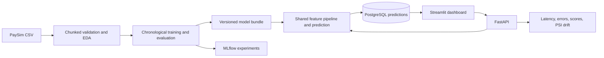

# Sentinel AI — Real-Time Fraud Detection & Risk Intelligence Platform

Sentinel AI is an educational end-to-end fraud-risk project built around PaySim’s synthetic financial transactions. It includes a data-quality and feature pipeline, supervised model training, a FastAPI scoring service, PostgreSQL persistence, a Streamlit dashboard, MLflow tracking, drift monitoring, Docker Compose, and CI.

**Scope:** this is not connected to banks or payment gateways and must not be used to make live financial decisions. A fraud score is a model output, a threshold is a configurable decision rule, a risk category groups scores, and only a reviewed ground-truth label can confirm fraud. Scores are not claimed to be calibrated.

The request schema uses PaySim's before/after balances, so the prediction point is after those balance updates are available. It demonstrates transaction-record triage, not pre-authorization risk blocking.

## What is implemented

- Chunked PaySim validation and reproducible sampled exploration.
- Leakage-aware transaction features shared by training and inference; chronological train/validation/test splits.
- Dummy, unweighted and class-weighted Logistic Regression, and class-weighted XGBoost comparison.
- Validation-only threshold choice, partition-labeled metrics, versioned joblib model bundles, JSON reports, and MLflow logging.
- FastAPI `/health`, `/ready`, `/predict`, `/predict/batch`, `/metrics`, `/model/info`, `/predictions`, `/overview`, and `/monitoring/drift` endpoints.
- SQLAlchemy models, Alembic migration, and repository methods for PostgreSQL (SQLite is useful for isolated API tests/local experimentation).
- Streamlit overview, transaction analysis, model performance, prediction history, and monitoring pages.
- Docker Compose, GitHub Actions, unit/API tests, and optional PostgreSQL integration test.

Implementation is present, but the full definition of done is **not verified** in this workspace: the PaySim file, pytest/Ruff, Docker, and a PostgreSQL service were unavailable during build. No measured model results are included. See [implementation status](docs/implementation-status.md).

## Architecture



Detailed system and request flow: [architecture](docs/architecture.md). Database relationships: [database schema](docs/database-schema.md).

## Dataset

Download `PS_20174392719_1491204439457_log.csv` from [Kaggle PaySim](https://www.kaggle.com/datasets/ealaxi/paysim1) and place it in `data/raw/`. See [data acquisition](docs/data-acquisition.md). Raw and processed data are Git-ignored. The trainer validates the dataset before fitting. The model excludes `isFraud` (target), `isFlaggedFraud` (rule leakage), `nameOrig`, and `nameDest` (identifiers).

## Install and prepare

Python 3.12 is recommended (3.10+ is supported). From PowerShell:

```powershell
cd "C:\Users\ss698\OneDrive\Desktop\AI ML"
py -3.12 -m venv .venv
.\.venv\Scripts\Activate.ps1
python -m pip install --upgrade pip
python -m pip install -e ".[dev]"
Copy-Item .env.example .env
```

Before starting containers, replace the `POSTGRES_PASSWORD` placeholder in `.env` with a local password. It is used by Compose for PostgreSQL. For local (non-container) use, also put that same password into `DATABASE_URL`.

Install the PaySim CSV in `data\raw\` before validation/training. The local default sample fraction for training is 10% per CSV chunk, fixed-seed and configurable; use `--sample-fraction 1` only with adequate memory. Quality validation still scans all rows.

## Data validation and exploration

```powershell
python -m sentinel_ai.data.explore --input data/raw/PS_20174392719_1491204439457_log.csv
```

The quality report covers row counts, schema, types, nulls, within-chunk duplicates, numeric and non-finite values, negative values, and fraud prevalence. EDA defaults to a fixed-seed 5% sample. Reports go to `reports/data-quality/`; generated reports are ignored by Git. Configure the sample with `--sample-fraction 0.01 --seed 42`.

For a batch-wise Parquet intermediate after validation, use `python -m sentinel_ai.data.prepare --output-dir data/processed/paysim_parquet`. It writes one Parquet part per CSV chunk and refuses to overwrite an existing output directory.

## Train and evaluate

MLflow local file tracking is the default:

```powershell
python -m sentinel_ai.models.train
```

For an MLflow tracking server, start one in another terminal and set `MLFLOW_TRACKING_URI=http://localhost:5000` in `.env`:

```powershell
mlflow server --host 127.0.0.1 --port 5000 --backend-store-uri file:./mlruns --artifacts-destination ./mlruns/artifacts
```

An explicit development-only run without MLflow is available with `--disable-mlflow`. Examples:

```powershell
python -m sentinel_ai.models.train --sample-fraction 0.02 --seed 42 --disable-mlflow
python -m sentinel_ai.models.train --input data/raw/PS_20174392719_1491204439457_log.csv --sample-fraction 1 --min-precision 0.5
```

The selection criterion is validation average precision, with recall as a tie-break. The threshold is selected on validation data for maximum recall subject to the configured precision constraint; if no threshold satisfies it, the validation F1-optimal threshold is used and constraint status is recorded. The selected model is evaluated once on the held-out latest time partition. Results are saved to `reports/model/evaluation.json` and `artifacts/model_metadata.json`; versioned and current model bundles are written under `artifacts/`. The report records the benchmark platform and CPU count for latency context. Metrics are not available until a real training run succeeds.

## Database and services

Start PostgreSQL and MLflow:

```powershell
docker compose up --build -d postgres mlflow
```

Train using the separately isolated training container (PaySim is read-only; only model/report output folders are writable):

```powershell
docker compose --profile training run --rm trainer
```

Start the API, apply the migration, and start Streamlit:

```powershell
docker compose up --build -d api dashboard
```

Open the dashboard at `http://localhost:8501`, Swagger at `http://localhost:8000/docs`, MLflow at `http://localhost:5000`, and health at `http://localhost:8000/health`. `/ready` requires both a loaded model and reachable database. Without a saved model, the API reports unavailable and refuses prediction requests.

For local non-container use, set `DATABASE_URL` in `.env`, apply `alembic upgrade head`, then run:

```powershell
uvicorn sentinel_ai.api.main:app --reload
streamlit run app/dashboard/Home.py
```

The compose file requires `POSTGRES_PASSWORD` from `.env`; keep that file private. Harden credentials and deployment controls before any shared environment.

## API example

```powershell
Invoke-RestMethod -Method Post -Uri http://localhost:8000/predict -ContentType 'application/json' -Body '{"transaction":{"step":12,"type":"TRANSFER","amount":125.0,"oldbalanceOrg":500.0,"newbalanceOrig":375.0,"oldbalanceDest":10.0,"newbalanceDest":135.0},"include_explanation":true}'
```

Example fields and response semantics: [API examples](docs/api-examples.md). These values are illustrative only, not a result from a trained model.

## Tests and lint

```powershell
python -m pytest -q
ruff check .
```

API unit tests use a deterministic test-only fake pipeline and in-memory SQLite; this is not training data or performance evidence. CI starts PostgreSQL, applies Alembic migrations, and runs unit/API/integration checks without downloading PaySim.

## Monitoring and known limits

The API reports process-local request/error/latency counters and score summaries. Persistent overview and history come from PostgreSQL. Drift uses PSI for amount and step compared with bounded training reference samples and a configurable recent prediction window. Drift does not estimate accuracy without labels and never triggers retraining. In-process counters reset when the API restarts. SHAP is bounded and falls back safely when unsupported; contributions do not prove fraud or causality.

PaySim is synthetic. This educational implementation has no authentication or authorization. Production use would need security, privacy review, model calibration and policy validation, reviewed labels, stronger monitoring, and infrastructure hardening.

## Documentation

- [Data acquisition](docs/data-acquisition.md)
- [Architecture](docs/architecture.md)
- [Database schema](docs/database-schema.md)
- [Model evaluation](docs/model-evaluation.md)
- [API examples](docs/api-examples.md)
- [Development roadmap](docs/development-roadmap.md)
- [Implementation status](docs/implementation-status.md)
