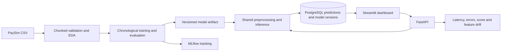
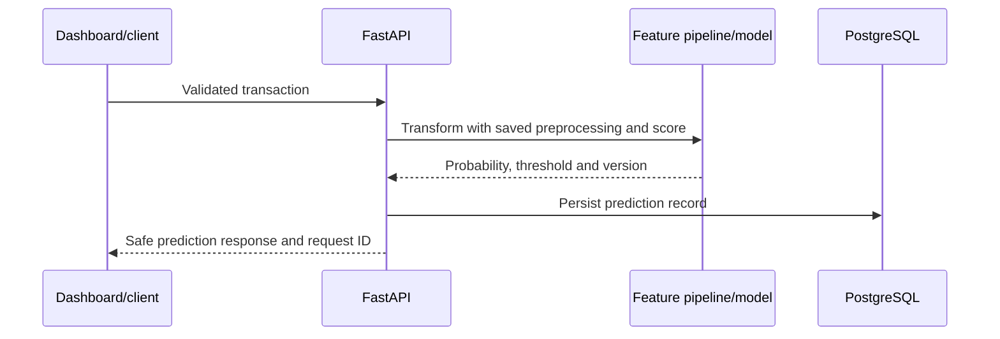

# Architecture (target design)

The codebase implements the flow shown below. Running the full flow requires the PaySim source file, installed dependencies, and a reachable PostgreSQL/MLflow setup.

## Principal prediction workflow

Model artifacts are produced by the offline training command and loaded by the API; the API does not train on startup. Prediction scores, operational thresholds, risk categories, and reviewed labels are distinct concepts. This educational system does not connect to payment rails and does not claim calibrated probabilities.

## Prediction timing

The input contract includes PaySim's before/after balance fields. This implementation scores a transaction record **after the transaction's balance updates are available**, for retrospective triage and analysis. It is not a pre-authorization model: `newbalanceOrig` and `newbalanceDest` would be unavailable before the ledger update. A true pre-authorization model would need to remove those fields and re-engineer/retrain using only pre-transaction data.
