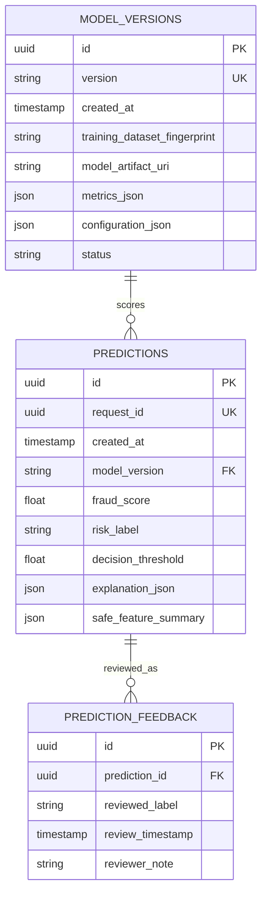

# Database schema

PostgreSQL is the primary application store, managed with SQLAlchemy and Alembic. Revision `0001_initial` creates the tables. SQLite can be used in isolated tests.

Raw training transactions will remain in CSV/Parquet files, not be inserted into PostgreSQL. Feedback is a reviewed label, never an automatic retraining signal.
